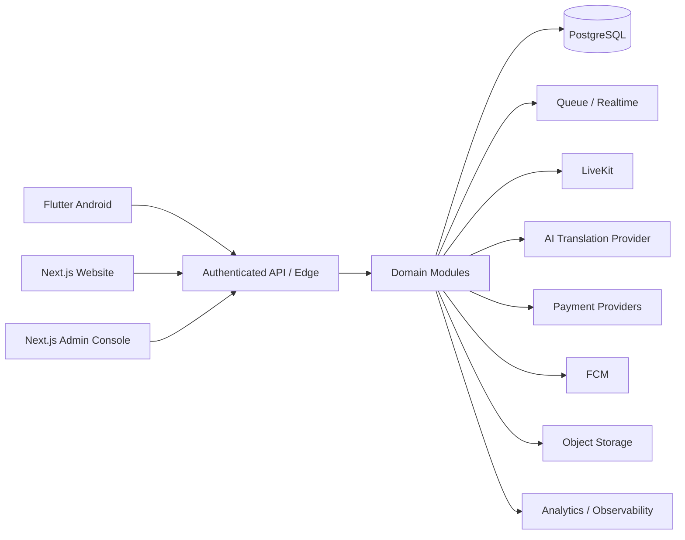

# VibeMingle V3 — Architecture Baseline

**Status:** Proposed baseline; ADR approval required before production decisions.  
**Scope:** V3-FINAL-SCOPE-LOCK-01. V1/V2/V3 remain one integrated product.

## 1. Architecture principles
- Modular monolith first for transactional domain logic; extract services only when scale, ownership, or isolation justifies it.
- Client applications never decide identity eligibility, match acceptance, sanctions, entitlements, wallet balance, payment fulfillment, or reward eligibility.
- API contracts and event schemas are versioned; domain transitions are explicit and idempotent.
- PostgreSQL is the transactional source of truth; realtime channels are delivery mechanisms, not authorization.
- Fail closed for identity, age eligibility, blocks, sanctions, room grants, payments, and wallet operations.
- Fail safely/degrade for noncritical AI translation, analytics, recommendations, and cosmetic features.
- Observability, cost limits, privacy, accessibility, and abuse resistance are built into each module.

## 2. Logical system context


## 3. Proposed stack
- Mobile: Flutter + Dart; feature-first modules; typed API client; secure local token storage.
- Web and Admin: Next.js + TypeScript; server components/actions only where authorization and runtime fit; explicit server-side checks.
- Backend baseline: Supabase Auth (Google identity), PostgreSQL, RLS, Edge Functions for suitable endpoints, and a dedicated trusted server/runtime for long-lived matchmaking, LiveKit orchestration, webhook processing, and jobs where Edge constraints are unsuitable.
- Realtime: Supabase Realtime for presence/UI events only where appropriate; durable queue and atomic reservation logic must be server-authoritative.
- Video: LiveKit; short-lived room tokens generated server-side with room/participant grants.
- AI: provider adapter interface; no provider lock until languages, latency, privacy, retention and cost tests are approved.
- Notifications: FCM with preference and consent enforcement.
- Storage: private buckets, signed upload/download URLs, moderation and retention policies.
- Hosting: Vercel for Next.js; backend placement selected after latency, region, jobs, secrets and compliance review.
- Observability: structured logs, traces, metrics, error reporting, audit logs and spend monitoring.

## 4. Repository topology (monorepo proposal)
```text
VibeMingle/
├── apps/
│   ├── mobile/                 # Flutter Android
│   ├── web/                    # Next.js public/user site
│   └── admin/                  # Next.js protected Admin Console
├── services/
│   └── api/                    # Trusted API, jobs, webhooks, orchestration
├── packages/
│   ├── contracts/               # OpenAPI/event schemas/shared types
│   ├── config/                  # Shared lint/tsconfig/env validation
│   └── web-ui/                  # Reusable web UI (only if justified)
├── supabase/
│   ├── migrations/
│   ├── functions/
│   ├── seed/
│   └── tests/
├── docs/
│   ├── product/
│   ├── architecture/
│   ├── security/
│   ├── operations/
│   └── decisions/
├── scripts/
├── .github/workflows/
├── .env.example
├── .gitignore
└── README.md
```

## 5. Trust boundaries
1. Public clients → API: untrusted input; schema validation, auth, rate limits and authorization required.
2. API → database: least-privilege credentials; RLS plus explicit server authorization.
3. Admin → privileged operations: MFA, permission check, reason code, confirmation and audit.
4. API → providers: server-side secrets, timeouts, quotas, retries with bounded backoff and circuit breakers.
5. Realtime/video: room/session binding, short-lived credentials, no broad room grants.
6. Webhooks: signature verification, replay protection, idempotency and reconciliation.
7. Storage: private by default, constrained signed URLs and lifecycle controls.

## 6. Data and service ownership
- PostgreSQL owns user/profile, eligibility, preferences, match/call metadata, social graph, moderation, entitlement and ledger state.
- LiveKit owns media transport; app backend owns room creation, grants and call lifecycle.
- Payment provider/store owns payment processing; backend owns verification and fulfillment records.
- AI provider processes only approved data for a consented session; backend owns consent, limits and session control.
- Analytics receives minimized, pseudonymous events; it is not a source of financial or moderation truth.

## 7. API conventions
- Version prefix (e.g. `/v1`) and generated client/contracts where practical.
- JSON schema validation; stable error envelope with machine code, safe message and request ID.
- Idempotency key for mutation endpoints that can be retried.
- Pagination cursor; explicit sort and maximum page size.
- UTC timestamps; server-generated IDs; no trust in client clock for enforcement.
- Rate limits by user, IP/device risk and action category.
- Sensitive fields omitted by default; admin-only data through dedicated permissions.
- No secrets, tokens, private evidence or raw sensitive payloads in logs.

## 8. Runtime and resilience
- Separate development, staging and production projects/secrets.
- Health/readiness checks; dependency timeouts; graceful shutdown.
- Bounded retries, circuit breakers, queue backpressure and dead-letter handling.
- Region-aware LiveKit routing and provider health; no silent unsafe fallback.
- Database migrations forward-compatible; backup/restore drills and rollback plans.
- AI/video/payment kill switches and per-provider budgets.
- SLO/RPO/RTO/capacity targets remain open approval decisions.

## 9. Architecture decision records required
- ADR-001: Modular monolith vs service boundaries and runtime.
- ADR-002: Supabase Auth + Google OAuth identity/session model.
- ADR-003: Match queue atomicity, queue technology and worker runtime.
- ADR-004: LiveKit region selection, token policy and reconnect model.
- ADR-005: AI translation provider, consent, retention and budget.
- ADR-006: Wallet ledger and purchase fulfillment invariants.
- ADR-007: Chat retention/encryption/reporting model.
- ADR-008: Age assurance and jurisdiction policy.
- ADR-009: Global data residency, routing and disaster recovery.
- ADR-010: Analytics minimization and experimentation governance.

## 10. Not yet approved / not yet implemented
This baseline does not create cloud resources, select final vendors, prove compliance, or implement services. Each ADR needs evidence, decision owner, alternatives, consequences, tests and approval.